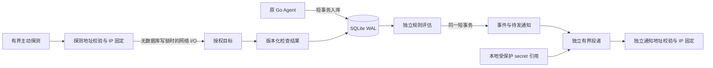

# Phase 04 架构与 S0 审计

基线 d9229319d553d0a9798116f31315b9f769aad66c（Phase 03 源码 ddfa464），工作区审计时干净。沿用既有表、会话、SQLite WAL 和单 worker；0001/0002/0003 不变。Phase 03 的 Linux 实机与部署缺口不在本阶段消除。

## 增量设计

service_checks 复用 host_id/name/kind/target/周期/超时/enabled，增加成功状态码范围、证书剩余天数阈值和持久化 next_run_at/revision。check_results 增加 HTTP 状态码、证书到期 UTC 秒和配置 revision；规则只读取当前配置版本的探测，旧版本结果仍可查历史；不存响应正文和目标凭据。

alert_rules 复用 threshold/operator/duration/severity 与现有指标枚举，增加 recovery_threshold、cooldown_seconds、target、channel_ids。memory_percent 明确定义为可用内存百分比，不能与 Dashboard 的已用内存百分比混淆。service_down 的 target 为白名单 unit 或 check:<id>；其余规则 target 可为空，disk_percent 可指定挂载点。

alert_instances 保留兼容 status=firing/resolved 及原有约束／活动唯一索引。新增 pending_since、fired_at、last_evaluated_at、data_status、last_value、acknowledged_at、silenced_until、last_notified_at。API state 派生为：firing 优先；非 firing 且 pending_since 存在为 pending；曾 firing 为 resolved；从未 firing 为 normal。四态计时全部持久化，不复制一个与 status 竞争的状态列。每个 rule/host/fingerprint 使用最新实例，写锁下去重；旧 resolved 历史可保留。缺失不会视作正常，不恢复 firing，并重置尚未触发的连续异常计时。禁用主机／规则暂停评估，重新启用重置 Pending，不跨未知期计时。

alert_events 保留 firing/resolved/acknowledged；确认与静默都是 acknowledged 管理审计事件，以 message 区分。被静默抑制的通知决定也更新时间戳，避免重复事件风暴。重复通知也是 firing 事件（message 区分 repeat）。确认抑制同次 firing 重复通知；恢复仍可通知；静默抑制该期限中的 firing/repeat/resolved 投递，不补发已静默事件。

notification_deliveries 即 Outbox：事件和每渠道待发记录同一 BEGIN IMMEDIATE 事务。添加 next_attempt_at、lease_until、idempotency_key、payload。测试投递 event_id 可空，通过该叶表批量重建完成；实际事件仍有外键。投递是至少一次语义，Webhook Idempotency-Key 与稳定邮件 Message-ID 供接收者去重；不能承诺 SMTP 外部 exactly-once。成功后崩溃可能重投。

## 出站安全

所有解析候选地址先校验，再只连接数值 IP；TLS SNI 与证书校验使用原始 hostname，禁止代理与重定向。默认仅全球可路由单播地址；拒绝私网、回环、链路本地、未指定、多播、保留、IPv4-mapped/隧道 IPv6。云元数据链路本地永远拒绝。运维可在中心受保护配置中分别指定探测与通知允许 CIDR；API 无权更改该策略。DNS 全部候选中任一个不安全则拒绝整个目标，候选最多 16；解析线程与未完成 DNS 工作总数限制 4，不无限排队。策略拒绝／DNS 忙显示 unknown，不能误认为服务宕机。DNS、连接、响应头共受超时控制；不读取业务响应体。

Webhook 独立安全策略；SMTP 也采用通知 CIDR 策略及强制 TLS（465 或 STARTTLS）。0004 在 DDL 前拒绝含非引用配置的旧渠道，要求先在维护窗口外置旧凭据（空 config 可保留待修复）。通知配置只存受保护目录中 JSON 文件的 basename 引用；目录须 0700、文件属当前中心用户、0600、普通单链接且非符号链接。API 不读回、接受或记录实际 secret。Webhook 文件包括 URL 和 Bearer Token；SMTP 文件包括地址、账号与密码。错误为固定类别，不包含 URL、凭据或异常原文。

## 调度与事务

lifespan 持有数据库相邻 flock 排他锁，第二调度器启动失败；单 Uvicorn worker。探测、评估、投递、保留各自独立循环与异常隔离。探测最多 4 并发／32 个待运行项；投递最多 2 并发／16 项；评估每批最多 100 对并有 2 秒软预算（当前短事务完成后退出），按规则／主机游标轮转。各任务事务短，网络调用全部在数据库会话关闭之后；失败写事务回滚并下轮重试。

探测持久 next_run_at 预留，更新配置 revision 后丢弃旧探测结果。投递持久租约，进程重启后到期可恢复；最多 5 次，指数退避含随机抖动。告警评估独立于采样入库，不改变 Agent 协议。停止先取消后台任务并 await，finally 关闭 socket；保留任务有单轮预算。

本阶段只做本地测试，不连接第三方通知目标，不修改或部署 Oracle/Google。

## 运维边界

探测历史和 Agent 原始数据保留 7 天；告警事件与投递审计目前不自动删除，需在 Phase 05 评估长期容量和备份。失败投递 5 次后保留 failed，不无限重试。已开始投递不保证能随渠道禁用撤回。DNS 使用最多 4 个原生解析线程；请求可超时／取消，底层已运行 getaddrinfo 由操作系统结束，不承诺强行终止原生解析。SQLite 忙等待最长 5 秒，规则批次软预算允许当前短事务收尾。多主机／多规则规模需实际容量评估，不能将本机基准直接当生产保证。
